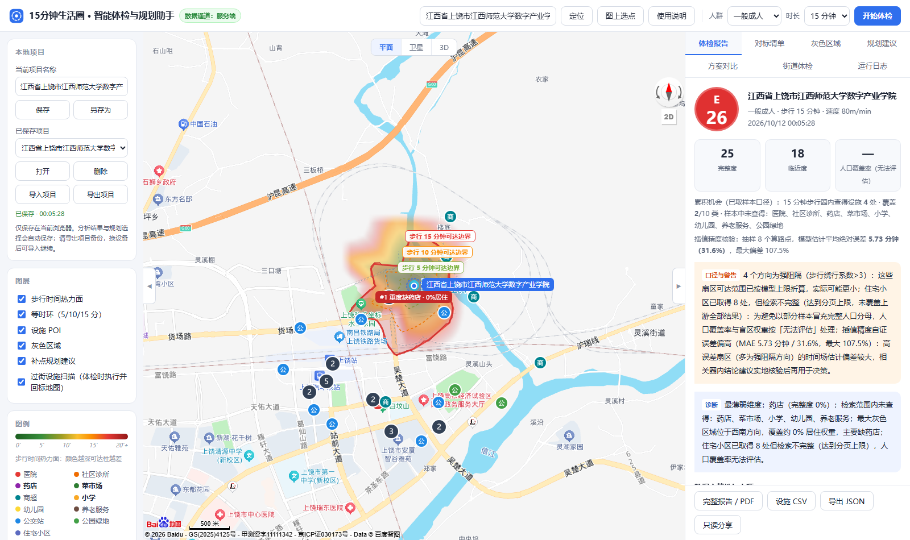
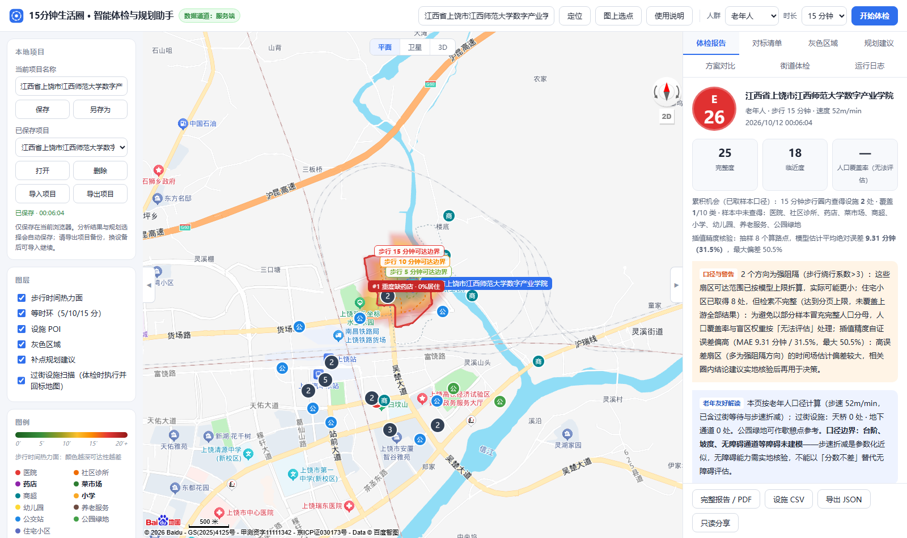
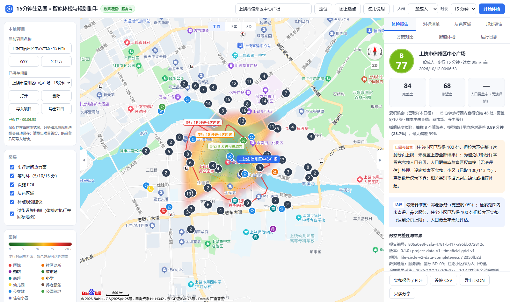
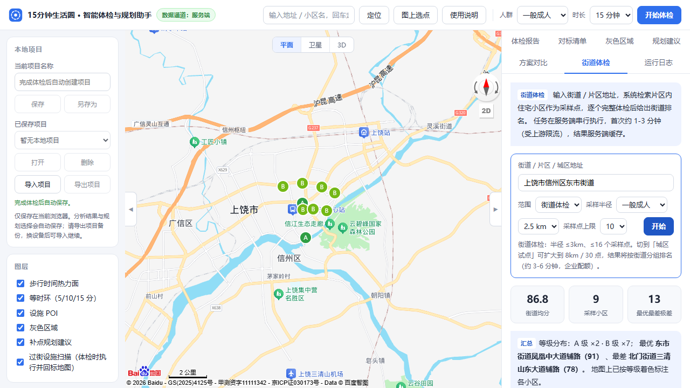
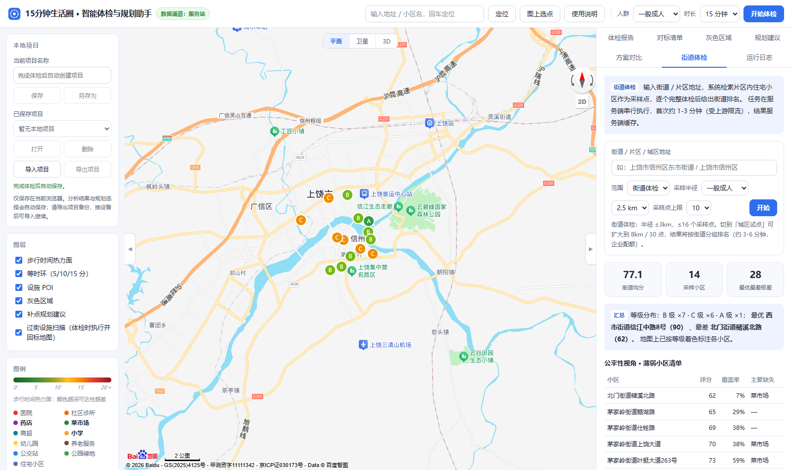

<p align="center">
  
</p>

<p align="center">
  <a href="https://github.com/wookat/life-circle-web/actions/workflows/ci.yml"></a>
  <a href="LICENSE"></a>
  
  
</p>

## 本地项目与数据完整性（新增）

- **保留工作进度**：体检完成和规划选择变化后自动保存到当前浏览器；侧栏可打开、重命名、另存、删除和导入／导出完整项目，刷新后恢复最近项目。
- **检索有边界**：每个关键词串行检索，最多 3 页、每页 20 条；报告逐项展示完整、截断、失败或未知状态，保存来源、采集时间及缓存记录。不完整数据不直接判定设施缺失。
- **结果可追溯**：报告和项目记录唯一编号、应用／算法／规则版本。核心类别或住宅样本不完整时，完整覆盖率显示无法评估；不兼容规则的历史快照保留查看，重新体检后再规划。

使用方式、容量限制与离线验收见 [项目保存与数据完整性说明](docs/PROJECTS_AND_DATA_QUALITY.md)。原“导出 JSON”仍是报告摘要；恢复工作台请使用侧栏“导出项目”。

## 方案对比与成果导出（新增）

- **保存 A / B 两套方案**：在「规划建议」选择补点，在「方案对比」记录、载入和更新 A / B。固定同一次体检数据，比较现状与两套方案的全覆盖率、新增覆盖百分点、剩余薄弱住宅网格和补点数；项目保存、刷新和文件导入导出均保留方案。
- **生成完整报告**：「完整报告 / PDF」打开可打印页面，包含矢量地图示意、现状指标、参考清单、A / B 对比、补点坐标、来源与警告；通过浏览器打印另存 PDF。不请求地图底图或额外接口。
- **导出表格**：「设施 CSV」输出当前分析的周边已取样本；街道批量任务完成后可导出薄弱社区 CSV，中文可直接在表格软件中打开。
- **点到设施路线核验**：地图设施弹窗点「步行路线核验」，按需获取真实路网步行距离，与时间场估计分钟数并列展示偏差；同一起终点本地缓存 6 小时，重复核验零消耗，获取失败如实提示、不伪装估计结果。

操作顺序、计算口径和边界见 [方案对比与成果导出说明](docs/COMPARISON_AND_EXPORTS.md)。覆盖改善是住宅 POI 权重下的直线服务盘模拟，不代表真实新增服务人口；数据不足时保留“无法评估”。

## 实测效果（历史提交批次）

以下截图和指标对应 `submission-2026` 的历史提交批次。新增分页与不完整数据处理后，重新体检可能得到不同结果；本次功能验收使用离线数据，未重新调用真实 AK 更新这些实测指标。

同一座城市，两个社区，系统的区分度。以下均为**服务端通道**（企业配额 AK · 48 向批量算路）的
正式实测口径（2026-10-10 批次，数字与下方截图同批）：

**样例 A · 新校区（成人）—— E 级 26 分 · 人口覆盖率无法评估**

药店、养老服务、菜市场、小学、幼儿园检索均为 0，医院与社区诊所各 1 家但都在 1.5km 外——
新建校区配套空白的典型案例；步行可达范围内未采样到住宅小区，人口覆盖率如实显示
「无法评估」（未知 ≠ 0%）；累积机会：15 分钟步行圈可抵达设施仅 **4 处 / 2 类**：



**样例 A · 老年人视角 —— 可达圈明显收缩**

步行速度 80 → 52 m/min，5/10 分钟环显著收缩；
累积机会从 4 处/2 类收缩至 **2 处/1 类**——老年人 15 分钟内几乎无任何核心设施：



**样例 B · 老城核心（对照）—— C 级 68 分**

医院 20 · 社区诊所 20 · 药店 20 · 幼儿园 20 · 公交站 20（触及检索返回上限），
累积机会 **34 处 / 8 类**，与样例 A 形成鲜明对比，验证系统区分度：



### 街道级批量体检 · 服务端通道实测

对样例 B 所在城区的**东市街道**发起批量任务：系统自动检索片区内 10 个住宅小区作为采样点，
逐个完整体检（48 向批量算路），**约 60 秒**给出街道排名、极差与公平性薄弱清单：



| 小区（按评分排序） | 评分 | 等级 | 人口覆盖率 | 主要缺失 |
| --- | --- | --- | --- | --- |
| 北门街道·以伟路 | **93** | A | 100% | — |
| 东市街道·胜利路155号 | 92 | A | 100% | — |
| 东市街道·滨江东路10号 | 91 | A | 99% | — |
| 西市街道·信江西路 | 91 | A | 99% | 菜市场 |
| 东市街道·民德路 | 91 | A | 100% | — |
| 东市街道·茶圣东路 | 89 | B | 100% | — |
| 北门街道·G320辅路 | 88 | B | 100% | — |
| 东市街道·紫阳南大道辅路 | 87 | B | 98% | — |
| 东市街道·青阳路 | 83 | B | **71%** | 菜市场 |
| 北门街道·三清山东大道辅路 | **79** | B | **71%** | 菜市场 |

街道均分 **88.4**（A×5 · B×5），**最优最差极差 14 分**；公平性视角自动生成薄弱小区清单——
青阳路与三清山东大道辅路均因**菜市场步行可达性不足**（覆盖率仅 71%）被点名，
这正是"从单个社区体检到整条街道公平性治理"的规划视角。发起一次后结果进入服务端缓存，重复演示零配额消耗。

### 城区级试点 · 信州区（scope=district）

视角再升一级：半径 5km / 16 个采样点覆盖大半个城区，14 个小区逐个体检，**约 90 秒**完成，
结果按街道分组排名：



| 街道 | 小区数 | 均分 | 薄弱数 | 最优 / 最差 |
| --- | --- | --- | --- | --- |
| 西市街道（老城核心） | 3 | **91.3** | 0 | 92 / 91 |
| 水南街道 | 2 | 81 | 1 | 86 / 76 |
| 茅家岭街道（高校新区组团） | 7 | **74.1** | **5** | 84 / 67 |
| 北门街道 | 2 | 70 | 2 | 76 / 64 |

城区均分 78.2、极差 28 分，薄弱清单 8 条（槠溪北路 64 分 / 覆盖率 7% 垫底）。
**茅家岭街道（高校新区组团，含样例 A）7 个小区 5 个薄弱**——「新区配套滞后」从主观感受
变为可量化的街道级结论。

完整数据、人工核对过程与误差来源见 [真实对比测试报告](docs/COMPARISON_TEST.md)。

### 演示视频

[](docs/video/圈点-核心功能演示.mp4)

▶ [docs/video/圈点-核心功能演示.mp4](docs/video/圈点-核心功能演示.mp4)（52 秒，无声走查版：
定位 → 48 向真实路网体检 → 热力面/盲区 → 规划建议采纳 → 对标清单 → 老年人视角对比。
配音解说版按 [docs/DEMO_SCRIPT.md](docs/DEMO_SCRIPT.md) 分镜录制。）

## 这是什么

「15 分钟便民生活圈」是国家推行的社区配套建设标准：居民步行 15 分钟内应能获得基础医疗、教育、购物、养老服务。传统评估依赖人工普查和静态直线距离，看不见**真实路网的绕行**，也说不清**缺了该在哪补**。

本项目基于百度地图开放能力（地理编码 / POI 检索 / 批量算路 / 步行路径规划）把这件事自动化：**输入一个中心点 → 计算真实路网的步行等时圈 → 统计圈内民生设施覆盖 → 标注人口加权的灰色区域 → 求解补点选址建议**。适用于社区体检、片区配套评估与规划讨论。

## 为什么不同

- **连续步行时间场，而不是一圈多边形** —— 48 向扇形采样 + 批量距离矩阵求各方向绕行系数，插值成 120m 网格的"走到中心要几分钟"连续场，渲染为平滑热力面与 5/10/15 分钟三层等时环；并附**累积机会指标**（圈内可步行抵达的设施总数/类别数，学界标准口径）与**插值精度自证**（每次分析抽样 8 个真实算路点实测 MAE，困难地形 4.35 分钟 / 22.8%，误差透明可查）；
- **体检之后给"处方"** —— 对每个灰色斑块用贪心最大覆盖模型求解补点位置与设施类别，输出量化收益（如"补建菜市场，该类居住覆盖率 68% → 100%"），这是多数同类工具没做的"规划助手"半边题眼；
- **体检结论分人群** —— 一般成人 / 老年人 / 儿童三档步行速度（80/52/65 m/min），同一社区在不同人群视角下可达范围与结论不同；
- **三级通道降级，演示永不中断** —— 服务端代理（AK 不出后端，带缓存与限流）→ 浏览器直连（GL SDK）→ 确定性合成数据；通道独立熔断，配额耗尽自动兜底；
- **分析能力开放为 API** —— `POST /api/analyze` 单点完整体检、`POST /api/batch/street` 街道/城区级批量体检（自动采样住宅小区逐个评分，按街道分组排名并生成公平性薄弱清单），附 OpenAPI 描述与文档页（`/api/docs`）。

## 工作原理

<p align="center">
  
</p>

等时圈模型：探针落在 `probeM = t·v` 直线半径上，批量算路返回真实路网距离，得到各方向绕行系数 `f(θ) = 路网距离 / 直线距离`，则该方向 t 分钟可达半径 `R(θ) = t·v / f(θ)`；对场做 marching squares 提取等时环。盲区判定沿用评分细则口径：**1km 内无菜市场/药店/小学**，缺 ≥2 项的连通区域聚合为灰色斑块，按住宅小区 POI 密度（人口代理）加权。算法细节见 [技术设计文档](docs/TECH_DESIGN.md)。

## 快速开始

**0. 无 AK 演示模式（开箱即跑）**

```bash
npm install
npm run dev        # 前端 5173 + 后端 8787
```

未配置 AK 时自动进入演示模式：确定性合成数据完整跑通全链路，页面明确标注「演示数据」。

**1. 接入真实数据**

在[百度地图开放平台](https://lbsyun.baidu.com)创建两个 AK（浏览器端 + 服务端各一），然后：

```bash
cp .env.example .env   # 填入 BAIDU_MAP_AK_BROWSER / BAIDU_MAP_AK_SERVER
npm run dev
```

> AK 安全：`.env` 已被 gitignore，真实密钥只存在于本地环境变量；浏览器端 AK 需配置 Referer 白名单，服务端 AK 配置 IP 白名单。

**2. Docker 一键部署**

```bash
cp .env.example .env   # 填好 AK
docker compose up --build
# 访问 http://localhost:8787 · API 文档 http://localhost:8787/api/docs
```

## 实测报告（赛题交付物）

针对上饶市两个真实社区 + 一个整条街道 + 一个城区级试点完成对比实测（含老年人视角、
双通道交叉验证、人工核对与插值精度自证），正式口径已统一为**服务端通道**：

- 样例 A（新校区·成人）：**E 级 26 分**，五类设施检索为 0，人口覆盖率如实显示「无法评估」（未知 ≠ 缺失）；
- 样例 A·老年人视角：可达圈收缩，累积机会 4 处/2 类 → **2 处/1 类**；
- 样例 B（老城核心）：**C 级 68 分**，医院/诊所/药店/幼儿园/公交站均触及检索返回上限；
- 街道批量（东市街道 10 小区）：均分 88.4，最优最差极差 14 分，薄弱清单自动生成；
- 城区试点（信州区 14 小区）：街道分组排名揭示**茅家岭街道（高校新区）7 个小区 5 个薄弱**；
- 算路交叉验证：GL SDK 单路径 3084m vs 服务端批量算路 3083m（误差 0.03%）；
- 插值精度自证：困难地形 MAE 5.73 分钟（31.6%）· 常规街区 3.89 分钟（23.7%）。

详见 [docs/COMPARISON_TEST.md](docs/COMPARISON_TEST.md)。

## 仓库导航

| 路径 | 内容 |
| --- | --- |
| `shared/` | 同构算法引擎：等时圈模型 / 时间场 / 盲区 / 评分 / 选址（前后端与单测共用） |
| `server/` | Node 服务端：AK 代理 · TTL 缓存 · 令牌桶限流 · 批量算路分片合并 · 分析引擎与街道批量任务 |
| `src/` | Web 前端：地图渲染 · 通道编排 · 报告面板 |
| `docs/TECH_DESIGN.md` | 技术设计文档：API 策略 / 等时圈算法 / POI 清洗 / 盲区算法 / 规划引擎 |
| `docs/COMPARISON_TEST.md` | 真实社区对比测试报告 |
| `docs/DEMO_SCRIPT.md` | 答辩演示脚本（5 分钟版 + 现场故障预案） |
| `tests/` | vitest 单元测试（19 项：坐标 / 时间场 / 盲区 / 评分 / 选址） |

开发命令：

```bash
npm run dev         # 前后端并行开发
npm run typecheck   # web + server 双 tsconfig 严格类型检查
npm test            # 单元测试
npm run build       # 生产构建（dist/ + dist-server/ 单文件）
```

## License

[MIT](LICENSE)
